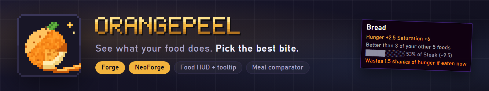
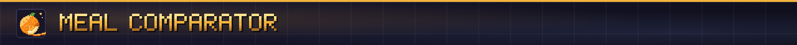
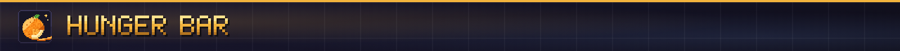
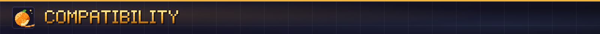
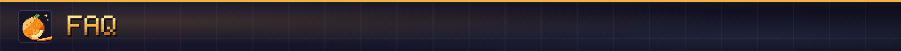

**See what every bite is worth, and which food in your pack is the best meal.**

OrangePeel shows what food does before you eat it. Hold a food and your hunger bar previews the points it restores, with the saturation and health regeneration it brings. Hover any food, anywhere, and the tooltip tells you the one thing other food mods leave out: how it compares with the rest of the food you are carrying.

Hover a food and OrangePeel ranks it against every other food in your inventory.

- **Ranked:** "Better than 4 of your other 6 foods", with a small bar showing how far it sits from your best one.
- **Best choice:** your best food overall is flagged, and so is the best pick for your hunger right now, so you stop wasting a big meal on a nearly full bar.
- **No waste:** if eating would overfill your hunger bar, the wasted points show in orange.
- **Effects:** names and durations of the effects a food gives.

- Restored hunger, shown on the bar before you eat, and drawn shanks, saturation and a comparison bar in the food tooltip.
- Golden rails for the saturation you have, and a tooltip line for how long a meal keeps you full.
- Health regeneration preview.
- Every overlay can be turned off, moved, or made more transparent in the config.

- Reads food values from the game, so modded foods work without extra support.
- The lines are added through the game's normal item tooltip, which item viewers such as JEI, EMI and REI use. Every graphic has a plain-text version.
- Other mods can add their own tooltip lines through a small API.

The pictures on this page are illustrations drawn for the listing, not game screenshots.

**Tested:** to be filled in at release with exactly what was played in a game client.

**Does it need to be on the server?** No. The overlay and tooltip run on your client.

**Does it change how food works?** No. It only shows information.

**Can I turn parts off?** Yes. Each overlay and tooltip line has its own setting.

**Fabric?** Not at this time.

**Can I use it in my modpack?** Yes. It's MIT licensed.

Made by ItMeCasey Studios. Source and issues on [GitHub](https://github.com/ItMeCasey/OrangePeel).
